# Hot Swap

[](https://github.com/R3mixt/hotswap/actions/workflows/validate.yml)

**See your current keybindings. Edit only what you want. Keep a way back.**

Hot Swap is a World of Warcraft addon with a visual keyboard editor, spellbook drag-and-drop, shareable presets, and named recovery backups. It uses Blizzard's native action slots rather than replacing your combat bars.

[Download on CurseForge](https://www.curseforge.com/wow/addons/hot-swap) · [Player guide](KeybindOptimizer/README.md) · [Documentation](docs/README.md) · [Changelog](CHANGELOG.md) · [Report a bug](https://github.com/R3mixt/hotswap/issues)

Version **1.0.0** is prepared for Classic Era / Hardcore user testing. Forever is a development target. Automated tests pass; live-client protected input, casting and third-party action-bar compatibility still need verification. The CurseForge download may lag the source version while a file is awaiting publication.

## What it does

- Opens on **Current**, your actual binding layout, with the miniature spellbook ready.
- Stages spell, item and game-control edits; applies them explicitly with a backup.
- Supports native spellbook drops, modifier layers, ranks and form-linked positions.
- Reserves unlearned spells without placeholder macros and fills owned reservations outside combat when learned.
- Creates character-specific macros only where conditional behavior requires them.
- Imports copy/paste profiles as additional presets without replacing your current settings.
- Offers independent replacement/swap confirmations, control protection and default-key restoration.
- Provides separate Movement and Camera spellbook sections; Current controls can be reassigned or explicitly left unbound.

## Screenshots

Choose **Classic** or **Modern** under **Settings → Window → Theme**. Classic remains the default. The choice applies immediately, stays local to your character, and preserves pending binding edits.

*These development previews are generated from the actual addon UI without running WoW. Both themes show the same sample bindings and real spell icons; fonts and frame artwork are approximate. The theme selector is in development after the 1.0 release.*

### Modern

Slate panels and cool accents, with the original spell artwork.

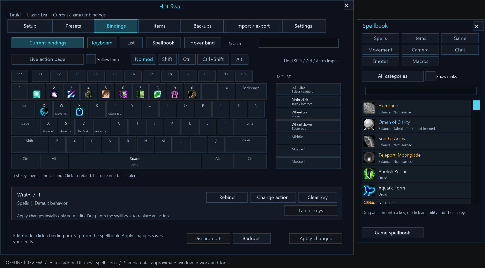

### Classic

Familiar Warcraft styling, warm borders and gold highlights.

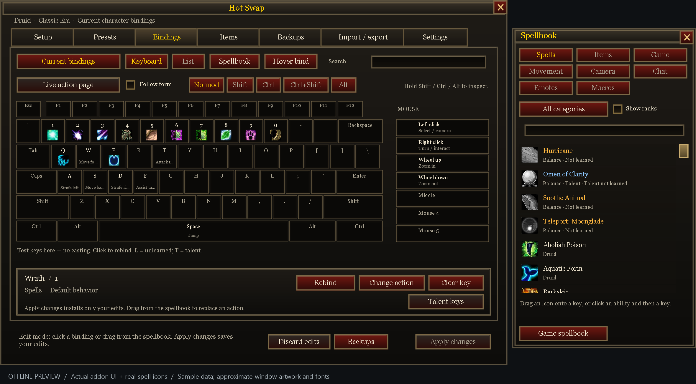

<details>
<summary>More screenshots: presets, appearance settings and the spellbook</summary>

### Presets

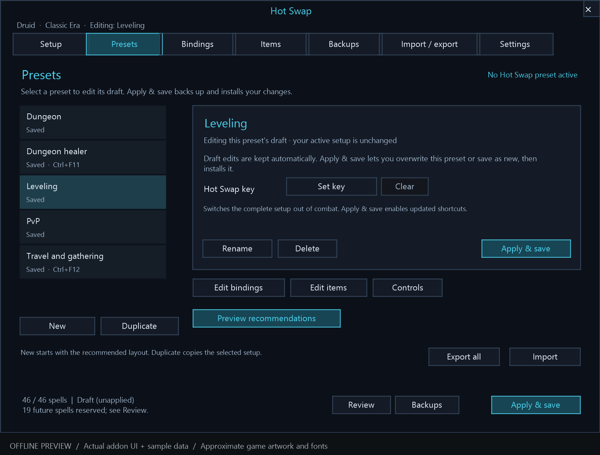

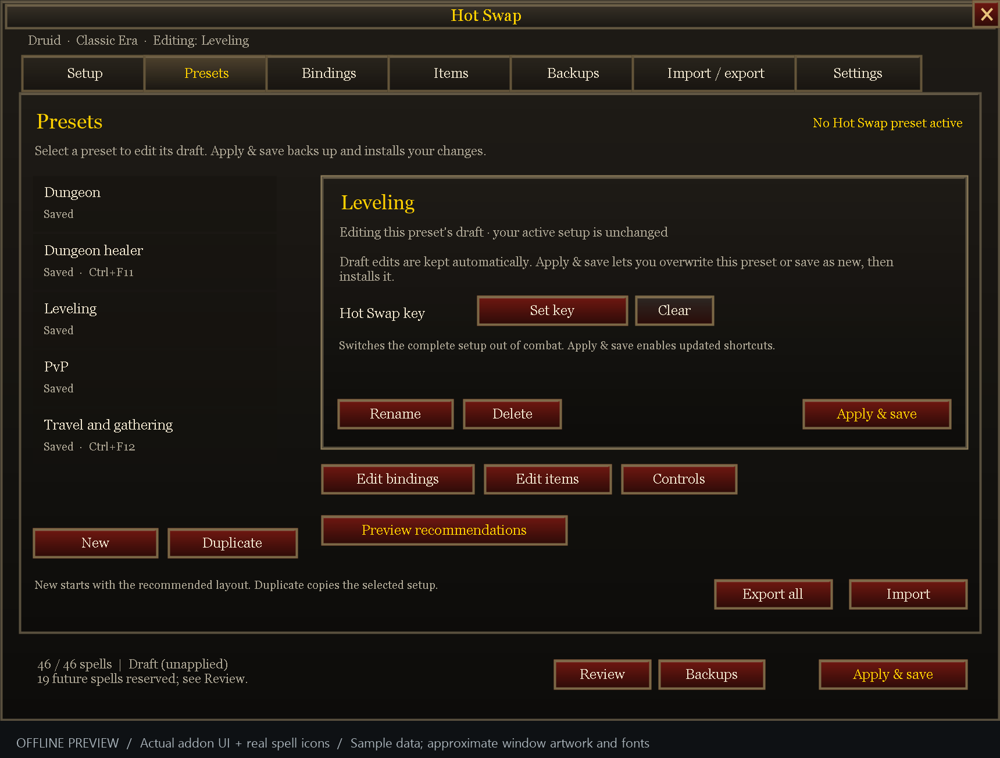

### Appearance settings

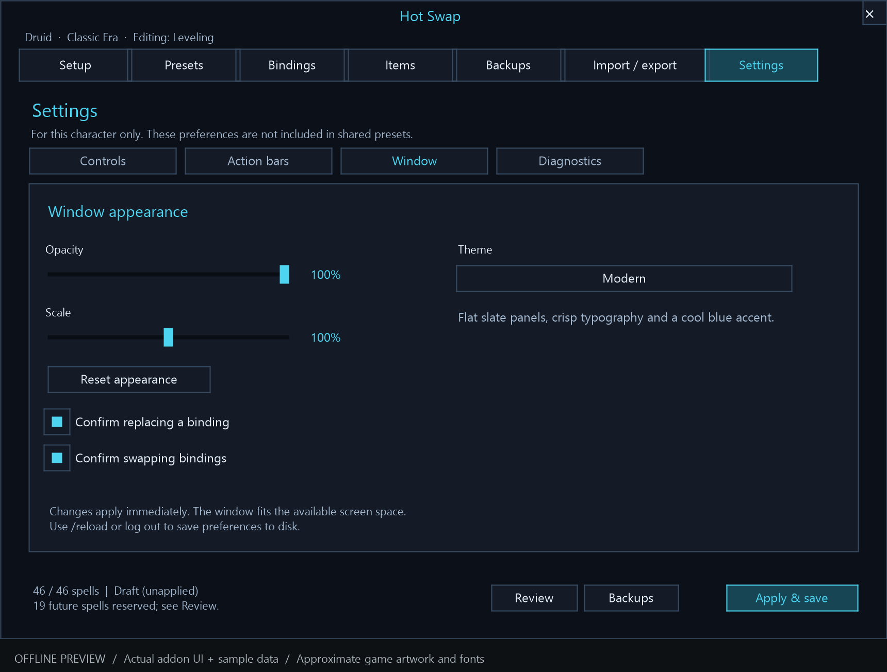

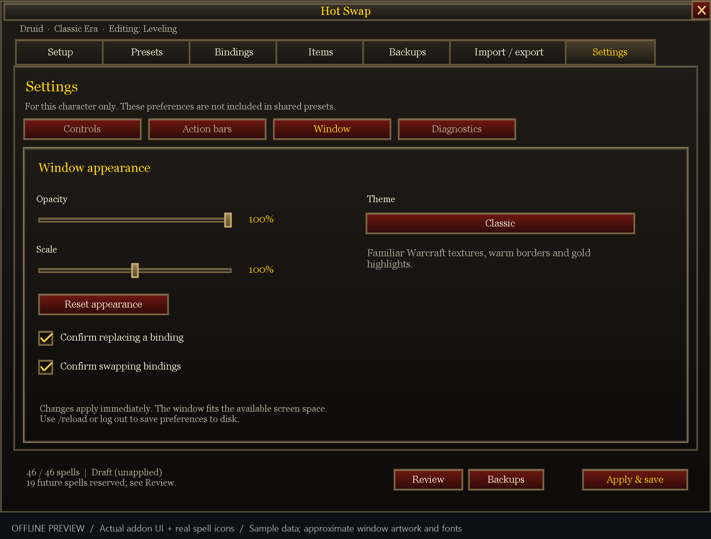

### Editing a preset

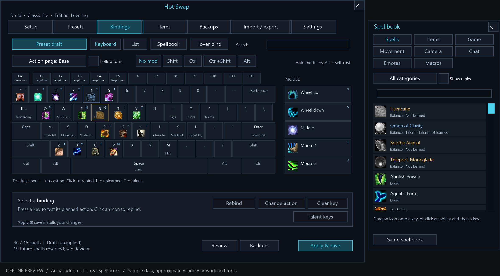

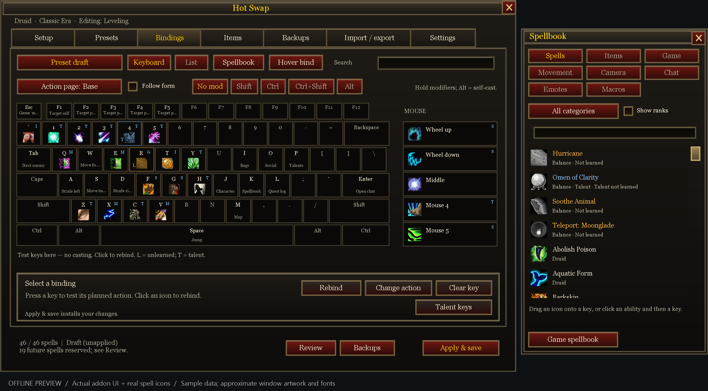

### Movement and camera controls

Separate sections make strafe, turn, zoom and other controls easy to find. In **Current**, choose **Clear key** to stage an unbound control, then **Apply changes** to save it.

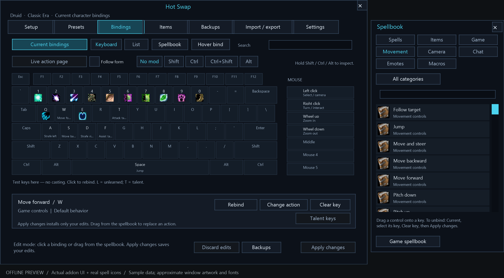

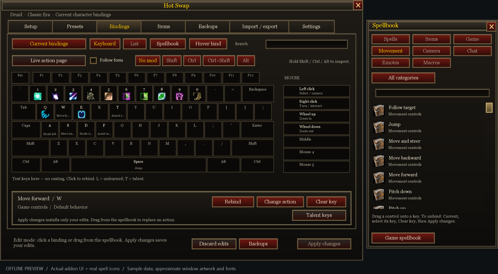

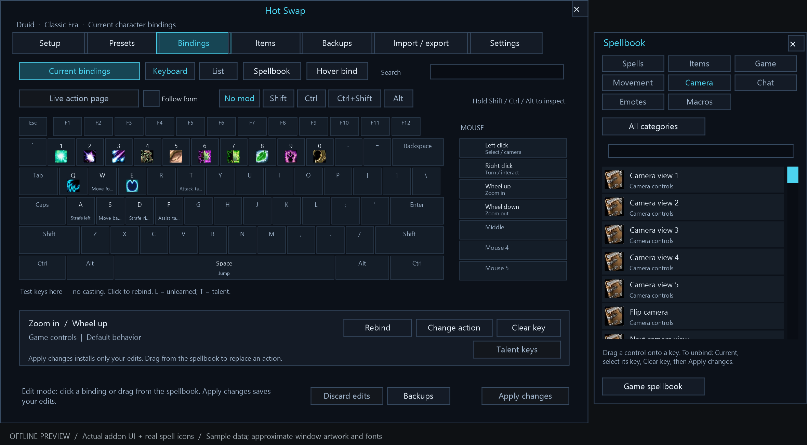

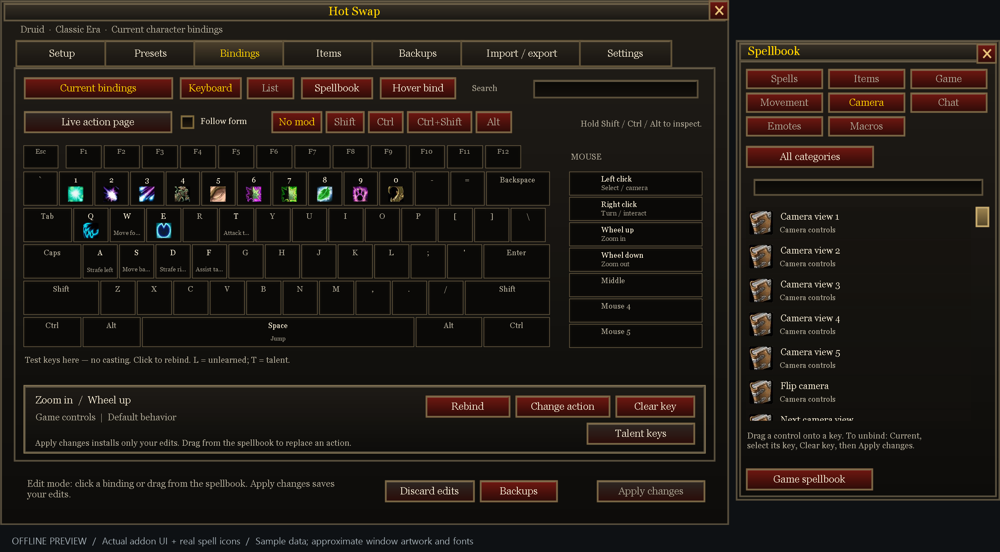

</details>

[Compare both themes](review/themes/theme-comparison.png) · [Theme guide](docs/themes.md) · [Generate previews without WoW](ui-qa/README.md)

## Install

1. Download the installable addon ZIP from CurseForge, or get a verified build from a successful [GitHub Actions run](https://github.com/R3mixt/hotswap/actions/workflows/validate.yml).
2. Extract **KeybindOptimizer** into your client's `Interface/AddOns/` folder. For Era / Hardcore, use `_classic_era_/Interface/AddOns/`.
3. Confirm the file is directly at `Interface/AddOns/KeybindOptimizer/KeybindOptimizer.toc`.
4. Restart WoW, enable **Hot Swap** at character selection, then type `/hotswap`.

For Actions downloads, unpack the `HotSwap-packages` artifact first, then use `HotSwap-<version>-CurseForge.zip` inside it. The developer-source ZIP is not an installable addon. If using GitHub's **Download ZIP**, copy only its `KeybindOptimizer` directory into AddOns.

The folder and SavedVariables name remain `KeybindOptimizer` for upgrade compatibility. The displayed addon name is **Hot Swap**. No Python or external libraries are required in game.

## First use

1. Inspect **Bindings → Current**. Opening the window changes no game bindings.
2. Drag a spell onto a key, or use **Hover bind**. Review replacements and modifier layers.
3. Choose **Apply changes** outside combat. Use **Discard edits** to abandon a draft.
4. For a complete preset, preview it in **Presets**, save a draft, then explicitly **Apply & save**.
5. Use **Backups** to restore a saved layout, the original setup, or Blizzard's default character keys.

To import a downloaded `.hotswap` profile, open it in a text editor and paste its complete code into **Import / export**. Imported presets remain separate until selected and applied.

## Compatibility and limits

Classic Era / Hardcore is the current testing focus. Retail and other Classic expansions are not supported release targets. Bartender/Dominos integration is best-effort: Hot Swap recognizes supported live action buttons but does not rewrite another addon's paging or override configuration.

Character macro capacity still applies. New presets leave optional utility form cancellation off to conserve slots; existing preferences are preserved. Protected setup changes wait for out-of-combat execution. The addon does not automate combat decisions or casts.

See the [behavior contract and acceptance checklist](docs/behavior.md) for exact behavior and the [1.0 review](docs/release-1.0-review.md) for evidence and remaining client checks.

## Develop and validate

Use Python **3.13** and Git:

```sh
git clone https://github.com/R3mixt/hotswap.git
cd hotswap
python -m pip install -r requirements-dev.txt
python tests/run_tests.py
python package.py
```

The 1.0 release passed **494 Lua 5.1 scenarios** and **7 packaging checks**. The Lua tests execute the addon modules against simulated WoW APIs. `package.py` reruns validation, checks the TOC and archive layout, and writes install/source ZIPs and SHA-256 files into `dist/`. GitHub Actions performs the same build on pushes and pull requests.

See [CONTRIBUTING.md](CONTRIBUTING.md) for the module map, change workflow and useful bug-report details. [CurseForge publishing](docs/curseforge.md) explains release sync and its one-time secret setup.

## License

[MIT](LICENSE). You may use, modify and redistribute the code under the terms of that license. World of Warcraft and its game artwork belong to their respective owners.
