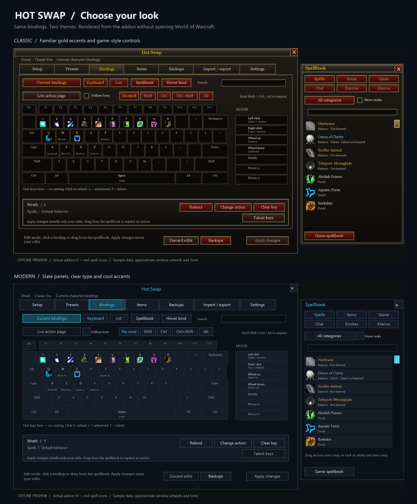

# Themes and offline previews

This development change follows the 1.0.0 release. Choose **Settings → Window → Theme** in Hot Swap.

| Theme | Appearance |
| --- | --- |
| Classic (default) | Familiar Warcraft textures, warm borders, gold highlights and game typography. |
| Modern | Flat slate surfaces, restrained borders, a cool blue accent and sans-serif typography. |

Theme changes apply immediately to Hot Swap's panels and editors. They do not reskin Blizzard's action bars or other addons. Spell icons keep their original artwork, dimensions and cropping in both themes, including the keyboard, spellbook and hover editor. Availability indicators retain their existing tint/desaturation. Button labels, selection markers, disabled states and warning text retain their meaning across themes.

The choice is saved per character in `KeybindOptimizerDB.preferences.theme`, separately from binding presets. Importing, exporting or switching a preset does not transfer the theme. Switching themes preserves Current edits and unapplied preset changes. Missing or invalid saved theme values fall back to Classic. **Reset appearance** restores Classic, full opacity and 100% preferred scale; it does not reset bindings or confirmation preferences. Use `/reload` or log out normally to persist preferences to disk.

## Screenshots without WoW

The offline harness loads the actual Lua addon modules against simulated game APIs, populates sample bindings, and captures the resulting widget tree. The renderer uses that tree's positions, text and styling to produce PNGs without starting the game. It does not read your character's SavedVariables.

These are **offline UI previews**, not in-game captures. Spell artwork comes from a preview-only asset cache; fonts and frame artwork are approximated. Earlier previews used letter placeholders and omitted some numeric icon references; the regenerated theme previews show recognizable icons in both themes. The preview cannot verify protected actions, actual casting, taint or compatibility with other addons. Each image includes an offline-preview label.

See [the preview harness guide](../ui-qa/README.md) for commands and output locations. Both themes use the same sample character and bindings so their appearance can be compared directly.

[Modern keyboard](../review/themes/modern-current.png) · [Classic keyboard](../review/themes/classic-current.png) · [Modern settings](../review/themes/modern-settings.png)
