# Hot Swap: product, UI/UX, system design and bug review

Reviewed 2 November 2026. Baseline: **0.4.4 beta**, commit `7d5d5f28a527bfa298ddc33f7a4670b0d24da5bf`.

**Recommendation: fix recovery correctness and editing-state consistency before adding more features or promoting the beta.** The existing architecture is worth keeping: native Blizzard bars, explicit installation, separate current/recommendation/draft data, typed imports, macro ownership, and bounded transaction workers. The largest professional-quality gains come from making those guarantees reliable across every entry point.

This is a review and implementation backlog. Runtime Lua, installed addon files, SavedVariables and account bindings were not changed.

## Evidence and limits

- Read the supplied handoff, player README, requirements, architecture, compatibility and prior review records; reviewed runtime and relevant tests across three independent review tracks plus integration review.
- Existing baseline: **404/404 actual-Lua-5.1 regression scenarios** and **7/7 packaging tests** passed. The 404-scenario suite also passed from the new permanent project folder using its own ignored dependency copy.
- Added **10 isolated defect reproductions across nine findings** using the actual addon modules and existing WoW mocks. These deliberately assert the observed defects; they are evidence, not acceptance tests for corrected behavior. F10 below is a separate source-inspected UI instruction defect.
- Generated 26 geometry previews and inspected representative Current, Recommendation, Presets, Items, Hover bind, Settings, Backups and failure-details screens. These approximate game artwork/fonts and are **not in-game screenshots**.
- Checked client UI source for native page priority, pet controls and keyboard API restrictions. Actual protected execution, taint, input routing, casting, server timing and Forever acceptance remain unverified.

The green baseline suite does not invalidate the new findings: several occur across subsystem boundaries or under recovery/failure conditions that the existing tests do not exercise end to end.

## Prioritized defects

P1 means fix before a wider beta/stable release because live behavior or preservation guarantees can be wrong. P2 means a reproducible correctness/workflow issue. P3 means a lower-impact resilience or usability defect. None is claimed to have been observed in a running client during this review.

| ID | Priority | Finding and user consequence | Primary source anchor | Evidence |
| --- | --- | --- | --- | --- |
| F1 | P1 | Named restore can report success while an overflow key points to the player's edited macro instead of the recovered action. | `Engine.lua:700` | Transaction reproduction 1 |
| F2 | P1 | Failed form maintenance can automatically restore the entire original setup, removing unrelated later personal keys and bar contents. | `Core.lua:195` | Transaction reproduction 2 |
| F3 | P2 | An unrelated key change between snapshot and completion can make both Apply and rollback fail verification. | `Engine.lua:583` | Transaction reproduction 3 |
| F4 | P2 | Items and Spells only can save draft edits while the UI remains in Current; Apply is disabled and related editor controls refuse. | `ItemsUI.lua:24`, `SettingsUI.lua:105` | Two UI reproductions |
| F5 | P2 | Preview recommendations inherits an old search/list state and can display no matching bindings instead of the proposed keyboard. | `UI.lua:1408` | UI reproduction 3 |
| F6 | P2 | Imported shortcuts bypass reserved-key/action checks and can prevent otherwise valid existing presets from applying. | `Presets.lua:545`, `Presets.lua:471` | Preset reproduction 1 |
| F7 | P2 | Copying a spellbook entry displaying a fixed rank can silently produce the highest rank at its destination. | `Library.lua:269` | Preset reproduction 2 |
| F8 | P2 | Selecting the unchanged installed preset marks it dirty and forces unnecessary installation/backup on the next activation. | `Presets.lua:96`, `Presets.lua:245` | State reproduction 1 |
| F9 | P3 | A native action read exception is silently displayed as an empty slot with no read error. | `CurrentBindings.lua:21`, `CurrentBindings.lua:174` | Injected read failure; state reproduction 2 |
| F10 | P3 | Empty-list instructions say “select All,” but the action-page menu has no All option. | `UI.lua:1631`, `UI.lua:1457` | Source inspection |

All source filenames above are under [KeybindOptimizer](../../KeybindOptimizer). Detailed supporting notes are [transaction review](transaction-notes.txt), [UI review](ui-findings.md), and [preset/data review](presets_findings.md).

### F1 — Verify recovered macro identity, not only its old command string

On a client with four extra bars, save an applied Warlock layout with an overflow direct `MACRO` binding. Personally edit its generated macro, restore the original setup, then restore the named applied backup. Hot Swap correctly preserves the personal macro and recreates the intended body under a suffixed name. However, the restored key still uses the snapshot's old name, and restoration reports success.

The reproduction binds `SHIFT-G` to `KBO_59b3776b` while the restored plan names `KBO_59b3776b_1`. This is specific to recovered direct/overflow references; native slot restoration already resolves replacement identity.

**Fix:** during macro recovery, map saved name + exact body to the resolved name. Reconcile authenticated owned references in the active and saved binding maps and ownership records. Verify the body reached by each restored direct macro key. Never rewrite arbitrary personal references merely because a name matches.

**Acceptance:** restore with missing macros, edited bodies, name collisions, reordered banks, native placements and overflow keys. Every restored owned reference resolves to the saved body; personal edits remain intact; subsequent maintenance and key release retain coherent ownership.

### F2 — Automatic maintenance recovery must preserve later personal work

Apply a Druid layout, then add an unrelated chat binding and item to a native slot. Edit the generated Cat macro and change the native form-index signature. Maintenance refuses to overwrite the personal macro, but Core responds with a full original Restore. The new key and item slot disappear and the addon becomes disabled. The reproduction uses the existing suite's deterministic form-index reorder fixture, with Core's normal recovery callback retained.

**Fix:** introduce a recovery-required state. Safely repair or neutralize only stale actions still demonstrably owned by Hot Swap, outside combat; preserve detached personal content and the recovery record. Offer an explicit full restore choice. Apply this policy to both synchronous/asynchronous maintenance failure and review the analogous login fallback at `Core.lua:315`. Simply ignoring stale form indices would also be unsafe.

**Acceptance:** end-to-end tests keep Core callbacks enabled. After edited/missing macro plus form changes, unrelated bindings, slots, drafts and personal macros survive. Affected unsafe owned actions are inert or repaired. Full original restoration is an explicit user action.

### F3 — Handle other binding writers during a yielding transaction

After Apply finishes its backup, pause for combat. Once combat ends, add an unrelated key before the next worker frame. Apply rejects the new key as unexpected; rollback rejects it again and reports recovery could not finish. The new personal key survives this reproduction. This is a narrowly timed concurrency case, not evidence that ordinary Apply always loses keys.

**Fix:** reconcile fresh live observations at resume and commit, record the operation's own mutations, and compare current values before reversing them. Preserve unrelated concurrent edits. Keep exact user-requested backup restore distinct from scoped automatic rollback. Do not bypass verification to make the error disappear.

**Acceptance:** unrelated additions, removals and changes after snapshot, at combat resume, and during rollback have a documented preservation policy; touched-key conflicts stop safely; saved binding sets and generated-macro cleanup remain consistent.

### F4–F5 — Centralize the transition into an editing or preview context

From a fresh Current view, Items → add item 1710 → Use this item persists a draft choice while Apply remains disabled. Edit key is enabled but refuses; Open spellbook returns to Current without opening it. Settings → Spells only similarly changes the draft without entering Draft. Separately, searching Current for a nonexistent term and then previewing recommendations leaves the recommendation hidden by that query in List view.

**Fix:** one explicit transition operation should set source and stable preset identity, clear incompatible focus/modal/selection/filter state, and update capabilities. Route every draft editor through it. The dedicated Preview recommendations action should open an unfiltered keyboard with a known layer/form state. Character-local preferences must remain independent.

**Acceptance:** start from Current, Recommendation and Draft; exercise Items mutations, rebind, spellbook, every preset-setting shortcut, search/list/form/layer combinations, and preview/save. Controls and handlers agree on editability. Preview/edits perform no gameplay writes; Apply is available only for a valid explicit draft.

### F6–F7 — Reuse validation and descriptor conversion across every entry point

Import accepts a `W` shortcut that interactive shortcut editing rejects. Because preset shortcuts participate globally, existing Leveling subsequently fails Apply. Copying a family entry labeled “Wrath · Rank 1” produces highest-rank Wrath instead because its descriptor drops the fixed-rank identity.

**Fix:** validate imported shortcuts against the proposed merged collection, including reserved controls and action conflicts. Leave conflicting imported shortcuts unassigned with an explanation while preserving the imported draft. Use one action-to-descriptor conversion that preserves the exact rank promised by the selected entry.

**Acceptance:** forbidden, protected, overlapping and valid imported shortcuts cannot disable unrelated existing layouts. Copy fixed rank, highest rank, custom/replacement spells and talent alternatives; resulting rank/target semantics match the selected entry without changing other form pages.

### F8–F10 — Make status and fallback information truthful

Selection alone calls Changed and sets dirty even when the preset signature is identical to the installed signature. The next activation therefore creates another backup and runs installation. Use content/revision comparison for unapplied status and no-op activation; navigation should not change it.

The current reader catches native API errors but loses the difference between “empty” and “unreadable.” Preserve that distinction, show an unavailable/read-error state, and retry through normal invalidation. The fault-injection reproduction proves the code path; it does not establish how often the client will throw there.

Add an All pages option specifically for List/search, or remove the unavailable instruction. A keyboard should still show one physical page at a time.

## Expected behavior and interaction contract

| User situation | What the user should see | Allowed result |
| --- | --- | --- |
| Open or reopen Hot Swap | Current character controls; actual native page and pet state | Read-only observation; no preset, backup or live write |
| Preview recommendations | Unfiltered proposed keyboard; clear unsaved label and assumptions | Temporary preview only |
| Save recommendation | A distinct named draft, visibly selected | Preserve existing custom presets; no live installation |
| Choose a saved preset | Draft name and separate installed-preset identity | Selection only; no false dirty flag |
| Enter Items/Controls editor | Explicit draft identity and applicable editor controls | Save edits to that draft; Apply remains explicit |
| Change a key or drag a rank | Exact intended action/rank/target, conflict explanation, linked-page impact | Draft change; undo available in the proposed design |
| Hover bind | Clear capture indicator, hovered action, resulting key, Done and Escape behavior | Consume test input; keep draft; no casting |
| Start Apply | Concise change summary, backup identity, progress | Fresh preflight; backup first; explicit writes only |
| Enter combat | Testing capture released; operation visibly paused if already started | No protected writes; no later activation queued from a rejected shortcut |
| A maintenance action fails | Specific affected action and recovery-needed state | Preserve unrelated work; do not silently reset everything |
| Explicitly restore a backup | Date/character/preset and clearly stated full restore scope | Restore verified saved behavior, preserving personal macro bodies |
| Edit local appearance/logging | Character-local scope and immediate result | No requirement to Apply a binding preset |

## Product and UI/UX improvement backlog

These are proposed improvements, not additional claims of broken implemented features. Keep the compact Blizzard-native visual style.

| ID | Priority | Improvement | Definition of done |
| --- | --- | --- | --- |
| U1 | Next | Persistent mode and scope banner | Current / Recommendation / Draft + name are unmistakable; Installed is separately identified; readonly views show inspection and the next useful action instead of a wall of disabled editing controls. |
| U2 | Next | Useful before/after review | Show keys changed/released, native slots replaced, macros created/reused and remaining capacity, protected controls, visibility/casting changes; link issues to their editor. Do not require an extra dialog for every harmless draft edit. |
| U3 | Next | Draft undo/redo and explicit revert | Undo a rebind/swap/drop/target/rank/item edit; distinguish Reset key, Reset action, Revert draft to installed, and Delete. Autosave status means saved draft, not installed game state. |
| U4 | Next | Search and discoverability | Visible search scope and clear-search action; All pages List; Hover bind search/form/category filters; usable future/rank/talent filters; names remain accessible when icons are small. |
| U5 | Next | One primary action per mode | Current offers inspection; Recommendation offers Save as new preset; Draft offers Apply. Remove duplicate panel/footer Apply on Presets. Clarify that New starts from recommendations, not the current native layout. |
| U6 | Next | Legibility and input-state clarity | Validate actual client fonts at supported viewport/UI scales; optional readable text density; text plus badges for unavailable/talent states; visible capture/Escape state and explicit normal-input status in combat. No accessibility compliance claim until measured in client. |
| U7 | Next | Recovery UI that explains scope | Preview selected backup metadata and major differences; explicit full-restore confirmation; show verified rollback versus recovery-needed; keep copyable errors and backup access prominent. |
| U8 | Next | Clearer Items interaction | Label the item-ID field and support item links where client APIs permit; show selected key and availability; explain alternatives are manual; distinguish Capture worn from immediate Equip saved. |
| U9 | Later | Preserve window placement and resilient layout | Avoid unnecessary recentering when fitting the spellbook; clamp/scroll menus; test long localized names, 70–130% preference scale, small screens and side panels. |
| U10 | Feature | Capture current layout as a new editable draft | Dedicated loss-aware representation for actual keys/native slots, exact local macro references, forms and unsupported content. Show capture completeness before saving. Never substitute class recommendations. |
| U11 | Feature | Explicit consumable selection policy | Optional best-food/water choice with visible criteria, availability and manual override. Planned bindings remain stable; no claim of automatic ranking before implementation. |
| U12 | Feature | Deliberately scoped pet layouts | First deliver accurate current pet inspection and tests. Treat pet identity, native slot order and autocast persistence as a separate capability-gated design with its own backup/restore contract. |

U10 is the most valuable larger feature for players who already have a custom setup, but it should follow the correctness work because it expands what the addon promises to preserve.

Representative reviewed geometry: [Current](evidence/bindings-current.png), [Recommendation](evidence/bindings-recommendation.png), [Presets](evidence/presets.png), [Hover bind](evidence/hover-bind.png). These are layout simulations, not client rendering evidence.

## System design assessment and targeted changes

The module boundaries are mostly appropriate. Keep one transaction engine and native action bars. Strengthen the contracts between the modules instead of rewriting the whole addon.

```mermaid
flowchart LR
  Live[Client bindings and native slots] --> Reader[Read-only current reader]
  Reader --> Current[Current view]
  Presets[Saved draft by stable ID] --> Context[Explicit planning context]
  Catalog[Catalog and client capabilities] --> Context
  Context --> Planner[Planner and shared validation]
  Planner --> Preview[Recommendation or draft preview]
  Preview -->|Explicit Apply of saved draft| Engine[Transaction engine]
  Engine -->|Backup then owned writes| Live
  Engine --> Installed[Verified installed plan]
  Installed --> Maintenance[Ownership-checked maintenance]
  Maintenance -->|Scoped updates outside combat| Live
```



This is a proposed dependency contract. In particular, explicit planning context and shared transition/identity services below are improvements to the current implementation, not claims that those abstractions already exist.

| ID | Priority | Design change and rationale | Verification |
| --- | --- | --- | --- |
| S1 | P1 | Typed operation intent: Apply, explicit full Restore, automatic maintenance and rollback have separate allowed write scopes. Addresses F2. | Assert permitted write sets through real Core callbacks, including failure and login paths. |
| S2 | P1 | One macro identity resolver for creation, native placement, direct keys, restore and maintenance; validate plan and executable bindings together. Addresses F1. | Body/name collisions, reindexing, missing macros, native and overflow references. |
| S3 | P2 | Transaction journal plus fresh observations on resume/commit; scoped automatic rollback preserves unrelated concurrent changes. Addresses F3. | Failure injection and controlled interleavings, with both saved binding sets and unsaved active map. |
| S4 | P2 | Explicit planning input: selected draft, items, capabilities, learned metadata, ownership and global shortcuts. Reduce temporary swaps of K.db/settings in recommendation and shortcut validation. | Pure deterministic builds; input objects unchanged even after exceptions; no preview writes. |
| S5 | P2 | Shared typed action descriptors and proposed-state validators for editing/import/copy/recovery. Addresses F6–F7. | Round trips preserve ranks/targets; rejected input has no partial saved/live mutation. |
| S6 | P2 | One UI context controller and editability predicate; split the 2,233-line UI.lua along state/navigation, bindings, presets and recovery responsibilities as those areas change. | Transition matrix above; enabled controls agree with handlers; no capture leaks. |
| S7 | P2 | Bound recovery storage with pinning, size visibility and deliberate retention. Engine appends full snapshots indefinitely, including the preset collection. Protect original and recovery-critical records. | Long-run switch/storage test; prune only eligible records; all retained backups restore. No measured memory/timeout failure is claimed yet. |
| S8 | P2 | Measure synchronous preparation and event work, not just the mutation worker. Coalesce meaningful pet/spell/item changes; cache draft conflict indexes by revision. | Real-client event bursts and large collections; record p95/worst durations before setting thresholds. SetHotkey currently builds all drafts and ValidateHotkeys builds them again. |
| S9 | P2 | Make export/import size limits compatible; add an import inspection/result summary with exact shortcut, macro and client-capability issues. | Every supported export is importable, or split/reject it before presenting unusable text. Current Import caps 2 MB/50,000 lines while Export-all has no matching cap. |
| S10 | P2 | Add end-to-end failure tests, targeted saved-data validation/migrations, and a client acceptance record per release. | Keep worker tests, but also exercise public entry points and Core fallbacks; quarantined corrupt entries preserve recoverable data; exact client/build evidence accompanies release status. |

The bounded six-step/four-ms worker, backup-before-write ordering, body-based ownership checks, capability gating, and installed-plan-only maintenance are foundations to preserve. A worker budget alone does not bound synchronous cloning, validation, event handling or SavedVariables serialization.

## Suggested implementation order

1. **Recovery and correctness patch:** F1–F3 first; F4–F8 next; F9–F10 alongside their related modules. Add desired-behavior regression tests for each fix. Keep the beta label.
2. **Coherent editing experience:** U1–U8 and the smallest S4–S6 refactors needed to support them. Add undo and useful change review before expanding the editable data model.
3. **Long-session reliability:** S7–S10, large-collection profiling, retention and import diagnostics, plus real-client acceptance across target classes/forms/pets.
4. **Expand carefully:** U10 current-layout capture, then optional consumable policies and scoped pet persistence. Keep recommendations editable heuristics; do not claim verified expert consensus without new evidence.

Avoid combining these phases into one broad rewrite. Small changes with focused regressions make recovery behavior easier to trust and bisect.

## Release acceptance gates

| Scenario | Required observation | Where to verify |
| --- | --- | --- |
| Fresh Mage and Warlock, no applied preset | Own actual bindings/bar contents; no class recommendations or mouse-control mutation on opening | Lua plus real Era/Hardcore |
| Preview → save → edit → apply | Preview makes zero writes/IDs/backups; save creates a distinct draft; Apply backs up and installs only after explicit action | Lua and client |
| Draft entry from every tab/context | Correct draft identity, editability, Apply state and autosave wording | UI transition tests and client |
| Edited/missing/reordered generated macros | Restore and maintenance preserve personal text and resolve exact intended owned bodies | Fault injection plus client macro bank |
| Form learn/unlearn/index changes | Correct native pages; no silent full original reset; unsafe stale actions handled explicitly | Druid/Warrior client and Core integration tests |
| Apply interrupted by combat or another binding writer | No protected writes; honest pause/progress; preserved unrelated state; successful or clearly bounded recovery | Async mocks plus client |
| Keyboard/hover/list/modal/search/drag transitions | No casts while preview/hover capture is active; correct focus and normal input in List/search; Escape hierarchy works; camera and gameplay input return on close/combat | Real input routing required |
| Pet summoned, changed and dismissed | Correct current icons/commands; accurate limitations; no claim of pet-order/autocast restoration | Hunter/Warlock client |
| Fixed rank, helpful Alt-self, unsupported focus/ground targets | Exact promised rank/target; unavailable modes rejected before writes | Lua and target client casting checks |
| Long sessions and large collections | Measured preparation/event/UI costs, bounded recovery storage, export/import compatibility | Stress fixtures plus client profiling |
| Window/scale/localization | Readable text, no overlaps, visible primary actions and clamped menus | Actual game renderer |
| Distribution | Correct immediate matching TOC, clean runtime manifest, no development/private artifacts | Packaging tests and candidate ZIP inspection |

Forever support and a stable/public release require separate actual-client acceptance. Retail remains experimental. This review did not install, publish or upload a release.

## Running the review evidence

From the project root with the normal development dependency installed (or the existing ignored `python-deps` folder):

```powershell
python tests/run_tests.py
python -m unittest discover -s tests -p test_package.py -v
python review/2026-11-02/transaction_repros.py
python review/2026-11-02/presets_repros.py
python review/2026-11-02/ui_probe.py
python review/2026-11-02/state_repros.py
```

The last four scripts describe baseline defects. After implementing fixes, replace their defect assertions with proper desired-behavior tests in the maintained suite; do not count them as successful product behavior.

## Primary client-source checks

- Native page priority and controller ownership were cross-checked against [Blizzard ActionBarController source](https://github.com/Gethe/wow-ui-source/blob/classic_era/Interface/AddOns/Blizzard_ActionBarController/ActionBarController.lua). Keep the game responsible for native form/vehicle/override pages.
- Pet inspection scope was checked against [Blizzard PetActionBar source](https://github.com/Gethe/wow-ui-source/blob/classic_era/Interface/AddOns/Blizzard_ActionBar/Shared/PetActionBar.lua). Native pet execution and autocast behavior are separate from storing a player binding preset.
- The generated [SimpleFrame API declarations](https://github.com/Gethe/wow-ui-source/blob/classic_era/Interface/AddOns/Blizzard_APIDocumentationGenerated/SimpleFrameAPIDocumentation.lua) mark keyboard APIs/properties with restrictions. Mocked input tests cannot certify client security or taint behavior.

These branch URLs are source checks, not immutable version pins or proof that every target client build behaves identically.
