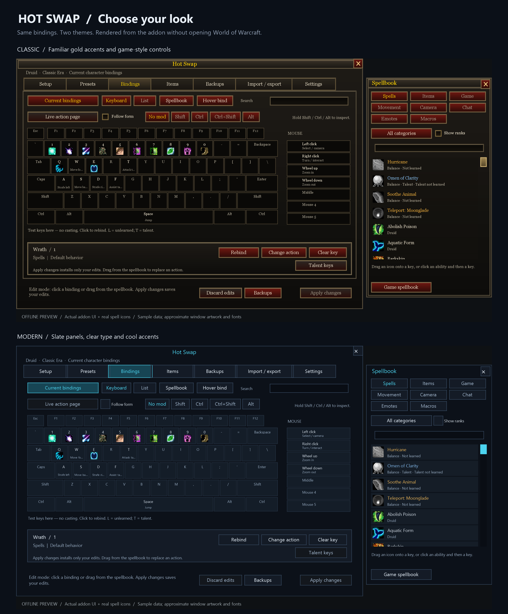

# Classic and Modern previews

Generated on 2026-11-02 from the actual development addon UI, without running World of Warcraft. The Lua harness supplies the same sample Druid bindings to both themes. Spell icons use recognizable game artwork from the preview-only cache; frame artwork and fonts remain approximations. These are not live-game captures.

| Screen | Classic | Modern |
| --- | --- | --- |
| Current keyboard and spellbook | [PNG](classic-current.png) | [PNG](modern-current.png) |
| Presets | [PNG](classic-presets.png) | [PNG](modern-presets.png) |
| Settings → Window | [PNG](classic-settings.png) | [PNG](modern-settings.png) |
| Draft keyboard and spellbook | [PNG](classic-spellbook.png) | [PNG](modern-spellbook.png) |
| Movement controls | [PNG](classic-movement.png) | [PNG](modern-movement.png) |
| Camera controls | [PNG](classic-camera.png) | [PNG](modern-camera.png) |

Images are exported at twice the logical UI resolution. [Reproduction instructions](../../ui-qa/README.md) describe capture and rendering. The theme choice is in **Settings → Window → Theme** and defaults to Classic.

## Verification

- The full Lua 5.1 regression suite passed, including the 13 theme tests preserving spell artwork, visibility, alpha, crop, tint and size across repeated theme switches in the keyboard, spellbook and lazy hover editor.
- 7 archive packaging checks and 8 publisher checks passed.
- Theme tests cover local persistence, invalid values, preset/export isolation, Current and preset drafts, reset, lazy dialogs, reversible native artwork/fonts, button and checkbox states, repeated switching, combat and busy-operation boundaries.
- Control tests cover separate Movement/Camera menus, unbound entries, native assignments, clearing individual aliases, persistence, recovery and stale-edit rejection.
- Visual review covered both themes, the populated keyboard, settings, preset lists and all eight spellbook tabs. Slider positions follow their actual values; text respects the widgets' wrapping settings. Classic inset artwork is drawn behind the footer help.

These checks do not establish in-game rendering, protected-input, taint or addon-compatibility behavior. No new public release is part of this development change.
